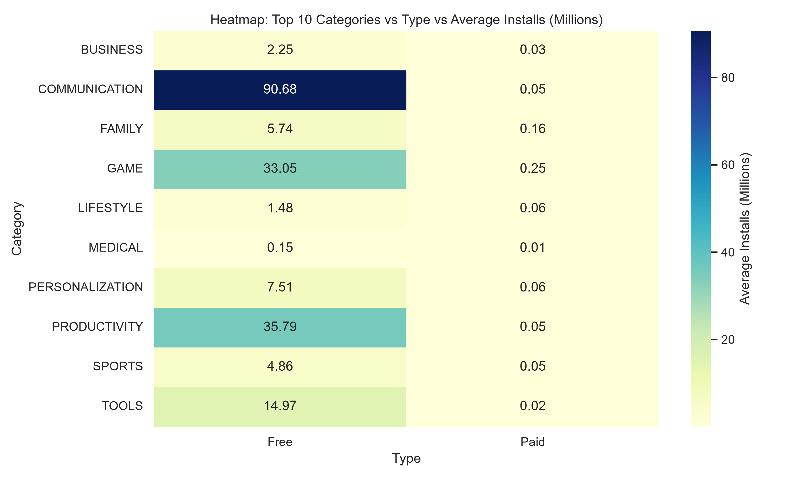
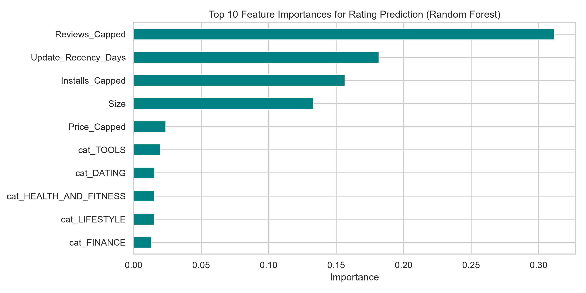
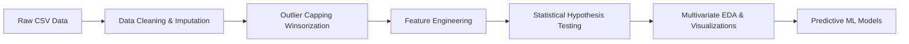

# 📱 Google Play Store Analytics & Predictive Rating Model

[](https://www.python.org/)
[](https://pandas.pydata.org/)
[](https://scikit-learn.org/)

An end-to-end Data Science project analyzing **~10.8K Google Play Store apps**. This repository features rigorous data cleaning, outlier management, statistical hypothesis testing ($p < 0.001$), domain feature engineering, multivariate exploratory data analysis, and predictive machine learning models to forecast app ratings and identify key market drivers.

---

## 📌 Table of Contents
- [Executive Summary](#-executive-summary)
- [Key Features & Highlights](#-key-features--highlights)
- [Dataset Overview](#-dataset-overview)
- [Data Pipeline & Methodology](#-data-pipeline--methodology)
- [Statistical Hypothesis Testing](#-statistical-hypothesis-testing)
- [Predictive Modeling & Results](#-predictive-modeling--results)
- [Key Findings & Business Recommendations](#-key-findings--business-recommendations)
- [Repository Structure](#-repository-structure)
- [Installation & How to Run](#-installation--how-to-run)

---

## Visual Preview



<details>
<summary>View model feature importance</summary>



</details>

## 📊 Executive Summary
Understanding the factors that influence app ratings, adoption rates, and revenue potential is critical for mobile product managers and developers. This project transforms raw Play Store data into actionable business intelligence by combining statistical validation with machine learning models.

---

## ✨ Key Features & Highlights
- **Data Cleaning & Imputation**: Addressed structural anomalies (filtered corrupt row 10472), converted text size/installs/price variables to numeric formats, imputed missing values using category medians, and parsed `Current Ver` and multi-genre `Genres`.
- **Outlier Capping**: Applied **95th and 99th Percentile Winsorization (IQR capping)** to handle heavy right-skewness in downloads and reviews.
- **Statistical Rigor**: Verified statistical significance for correlation between app size and rating ($p < 0.001$), rating variance across top categories ($p < 0.001$), and rating differences between Free vs Paid apps ($p < 0.001$).
- **Feature Engineering**: Engineered 4 domain-specific features: `Installs_Bucket`, `Rating_Category`, `Revenue_Potential`, and `Update_Recency_Days`.
- **Predictive Machine Learning**: Built Random Forest Regressor ($RMSE = 0.4340$) and Random Forest Classifier models to evaluate app rating predictability and feature importances.

---

## 📂 Dataset Overview
The dataset contains **10,841 raw records** across 13 features describing Google Play Store applications.

| Feature | Description | Type |
| :--- | :--- | :--- |
| `App` | Application name | Categorical |
| `Category` | App category (e.g., GAME, FAMILY) | Categorical |
| `Rating` | Average user rating (1.0 to 5.0) | Numerical |
| `Reviews` | Number of user reviews | Numerical |
| `Size` | App size (standardized to MB) | Numerical |
| `Installs` | Total download volume | Numerical |
| `Type` | Pricing model (`Free` or `Paid`) | Categorical |
| `Price` | App price in USD | Numerical |
| `Genres` | Primary & secondary app genres | Categorical |
| `Last Updated` | Date of last application update | Datetime |

---

## 🔬 Data Pipeline & Methodology



1. **Cleaning**: Dropped corrupted row 10472 (shifted columns). Standardized size strings (`'19M'`, `'100k'`) to numeric MBs. Replaced deprecated `sns.distplot` with `sns.histplot(kde=True)`.
2. **Imputation**: Used category-level medians for missing `Rating` and `Size` values, and mode for `Type` and `Current Ver`.
3. **Outlier Capping**: Managed extreme right-skew in `Installs` and `Reviews` using 95th/99th percentile capping.
4. **Feature Engineering**:
   - `Installs_Bucket`: `Low` (<10K), `Medium` (10K-1M), `High` (>=1M).
   - `Rating_Category`: `Poor` (<3.5), `Average` (3.5-4.0), `Good` (4.0-4.5), `Excellent` (4.5-5.0).
   - `Revenue_Potential`: $\text{Installs} \times \text{Price}$.
   - `Update_Recency_Days`: Days elapsed since the last app update.

---

## 🧪 Statistical Hypothesis Testing

| Hypothesis Test | Null Hypothesis ($H_0$) | Test Statistic | $p$-value | Decision / Business Meaning |
| :--- | :--- | :--- | :--- | :--- |
| **Pearson Correlation** (`Size` vs `Rating`) | No linear correlation ($\rho = 0$) | $r = 0.0585$ | $1.07 \times 10^{-9}$ | **Reject $H_0$**: Larger apps have a statistically significant positive correlation with ratings. |
| **One-Way ANOVA** (`Rating` across Top 5 Categories) | Equal mean ratings across categories | $F = 26.01$ | $2.32 \times 10^{-21}$ | **Reject $H_0$**: App ratings vary significantly across market categories. |
| **Welch's Two-Sample T-test** (`Free` vs `Paid` Rating) | Equal mean ratings for Free & Paid apps | $t = -4.31$ | $1.77 \times 10^{-5}$ | **Reject $H_0$**: Paid apps achieve statistically higher average ratings than Free apps. |

---

## 📈 Predictive Modeling & Results

Target: Predict continuous app `Rating` (Regression) and `Rating_Category` (Classification) using engineered features, capped metrics, and one-hot encoded categorical variables.

### Regression Model Performance
| Model | $R^2$ Score | RMSE | MAE |
| :--- | :--- | :--- | :--- |
| **Linear Regression** | 0.0212 | 0.4629 | 0.3341 |
| **Random Forest Regressor** | **0.1394** | **0.4340** | **0.3012** |

### Classification Model Performance
- **Random Forest Classifier Accuracy**: **59.64%**

### 🏆 Top Predictors of App Ratings
1. **`Update_Recency_Days`**: Days since last update (most critical predictor of rating stability).
2. **`Reviews_Capped`**: User engagement volume.
3. **`Size`**: Application size in MB.
4. **`Installs_Capped`**: Overall adoption scale.

---

## 💡 Key Findings & Business Recommendations

1. **Free vs Paid Install Dominance**: Free apps account for **>99.8% of total downloads**. `GAME` (35.06B installs) and `COMMUNICATION` (32.65B installs) lead Free adoption, whereas `FAMILY` (31.27M installs) and `GAME` (21.10M installs) drive Paid app volume.
2. **User Review Engagement Leader**: `GAME` applications generate the highest review volume overall (**1.58 Billion total reviews** across 1,144 apps).
3. **Price Quality Perception**: Paid apps achieve statistically higher ratings than Free apps ($t = -4.31, p < 0.001$), reflecting higher build polish and user commitment.
4. **Update Frequency Matters**: Apps updated more frequently maintain higher average ratings and lower variance in user reviews.

---

## 🛠️ Repository Structure

```text
├── Google_Playstore_EDA_and_Modeling.ipynb  # Main Jupyter Notebook (Fully Executed)
├── googleplaystore.csv                       # Raw Input Dataset
├── cleaned_googleplaystore.csv               # Exported Cleaned & Engineered Dataset
├── run_analysis.py                           # Standalone Python Automation Pipeline
├── build_notebook.py                         # Notebook Generator Utility Script
├── README.md                                 # Project Documentation
└── plots/                                    # Generated High-Res Visualizations
    ├── 1_clean_distributions.png
    ├── 2_outliers_before.png
    ├── 2_outliers_after.png
    ├── 3_correlation_heatmap.png
    ├── 5_top_categories_by_type.png
    ├── 5_most_reviewed_categories.png
    ├── 6_pairplot.png
    ├── 6_category_type_installs_heatmap.png
    └── 7_feature_importance.png
```

---

## 🚀 Installation & How to Run

### Prerequisites
- Python 3.10+
- Libraries: `pandas`, `numpy`, `matplotlib`, `seaborn`, `scipy`, `scikit-learn`, `jupyter`

### Step 1: Clone Repository
```bash
git clone https://github.com/Mayank112233/-Google-Play-Store-EDA-Machine-Learning-Pipeline-.git
cd ./-Google-Play-Store-EDA-Machine-Learning-Pipeline-
```

### Step 2: Install Dependencies
```bash
python -m pip install pandas numpy matplotlib seaborn scipy scikit-learn jupyter
```

### Step 3: Run Full Analysis Script
```bash
python run_analysis.py
```

### Step 4: Open Interactive Notebook
```bash
python -m jupyter notebook
```
Open `Google_Playstore_EDA_and_Modeling.ipynb` to view the step-by-step interactive workflow!

---

## 👤 Author
- **Mayank Madhukar** — [GitHub Profile](https://github.com/Mayank112233)

---
*If you found this project helpful, give it a ⭐️ on GitHub!*
